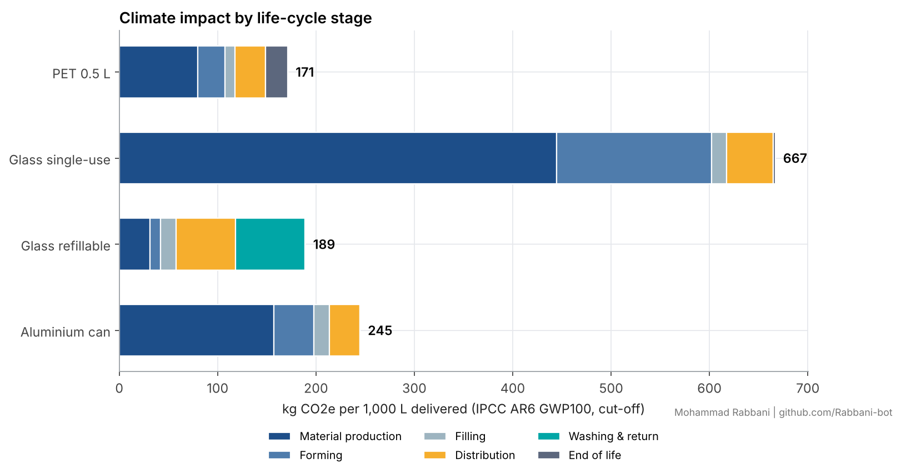

# Comparative LCA of beverage packaging (ISO 14040/44 structure)

[](https://github.com/Rabbani-bot/lca-beverage-packaging/actions/workflows/tests.yml)  

> **Inventory.** Unit-process values are rounded figures within ranges typical of public LCA literature, not values from ecoinvent or another licensed database. Replace them with licensed or primary data before making product claims.



## Goal and scope
| Item | Choice |
|---|---|
| Functional unit | Delivering 1,000 L of carbonated soft drink to retail |
| Systems | PET bottle 0.5 L (22 g, 25% recycled content); single-use glass 0.33 L (200 g); refillable glass 0.33 L (350 g, 25 trips); aluminium can 0.33 L (13 g, 70% recycled content) |
| Boundary | Cradle to grave: material production, forming, filling, distribution, washing and return logistics, end of life |
| Impact categories | Climate change (GWP100, **IPCC AR6**: CH4 29.8, N2O 273), cumulative energy demand, water use |
| End-of-life allocation | Cut-off (base case) and substitution/avoided burden (sensitivity, 0.9 quality factor) |
| Uncertainty | 10,000-run Monte Carlo. Lognormal distributions on foreground parameters and on all unit processes (GSD 1.15). Background draws are shared across systems so comparisons are paired. |

## Results
| System | GWP, kg CO2e | MC median [P5, P95] | CED, MJ | Water, L |
|---|---|---|---|---|
| PET 0.5 L | **171** | 174 [145, 210] | 3,788 | 1,191 |
| Glass refillable | 189 | 195 [144, 273] | 2,986 | 1,731 |
| Aluminium can | 245 | 248 [195, 312] | 3,657 | 1,010 |
| Glass single-use | 667 | 675 [569, 804] | 9,937 | 2,182 |

**Main findings**
- Single-use glass is worst on every indicator in 100% of Monte Carlo runs. Material production and forming account for 90% of its impact.
- **PET versus refillable glass depends on context.** Refillable glass has lower GWP in only 30% of runs at 300 km. It breaks even with PET after **15 trips at 50 km, 17 at 100 km and 24 at 200 km**, and never within 40 trips beyond about 300 km. For refillable glass, distribution and washing make up 69% of GWP.
- The tornado analysis ranks the drivers for refillable glass: distribution distance (−45 / +90 kg), then trips, washing heat and bottle mass.
- Refillable glass has the lowest energy demand. Aluminium has the lowest water use. No system wins on every indicator.
- Method choices: substitution lowers results by 2–8%. Switching AR5 to AR6 barely matters, because CO2 dominates these systems.

## Figures (`outputs/figures/`)
1. Contribution of each life-cycle stage
2. Monte Carlo violin plots
3. Pairwise probability matrix (P lower GWP)
4. Tornado sensitivity analysis
5. Break-even heatmap (trips × distance)
6. Recycling-rate scenarios: cut-off vs substitution
7. Normalised multi-indicator heatmap
8. Sensitivity to method choices (allocation, AR5/AR6)

Tables 1–6: foreground parameters, deterministic results, stage contributions, Monte Carlo summary, probability matrix, mass balance check.

## Validation
Seven unit tests check that:
- the AR6/AR5 characterisation factors are exact;
- the mass balance closes;
- results scale linearly with the functional unit;
- more trips lower the impact;
- the substitution credit has the correct sign;
- the Monte Carlo median stays centred on the deterministic result;
- unit processes are restored after sampling.

```bash
python src/analyze.py && python -m pytest tests
```

## Links
- Kaggle notebook (runs end-to-end on Kaggle): https://www.kaggle.com/code/rabbani0123/comparative-lca-of-beverage-packaging-iso-14040
- Cite: see `CITATION.cff`
- Author: Mohammad Rabbani | Sustainability Data Analyst & Research Assistant

## License
MIT
